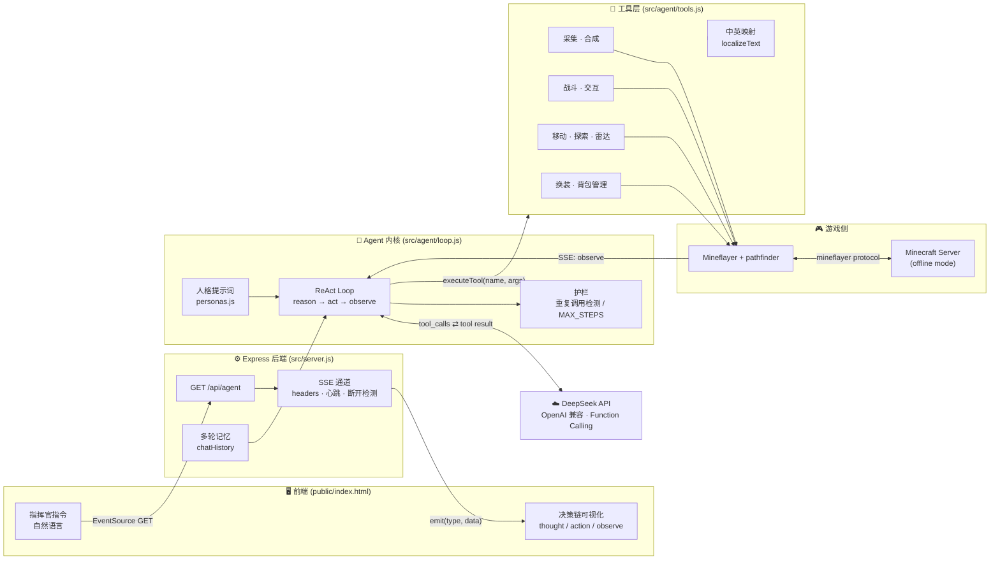

# MC-Agent · Minecraft Autonomous Agent


```text
 __  __  ___          _                    _
|  \/  || __|   __ _  __ _  ___ _ _   | |_
| |\/| || _|   / _` |/ _` |/ -_) ' \  |  _|
|_|  |_||___|  \__,_|\__, |\___|_||_|  \__|
                     |___/
        Minecraft Autonomous Agent / ReAct in the wild
```

---

## 项目简介

**MC-Agent** 是一个由大语言模型驱动的 Minecraft 独立生存智能体：你说一句"帮我搞把铁镐"，它自己拆任务、找矿、挖矿、合成、遇到岩浆会绕路、背包满了会清理。它解决的核心痛点是——**通用 LLM 只有"嘴"，没有"手"**，而传统脚本只有"手"，没有"脑子"。在这里，你扮演**指挥官**，只下达宏观意图；Agent 扮演**执行者**，通过思考-行动-观察的循环，把自然语言翻译成一连串真实发生在方块世界里的动作。

---

## 核心特性

### 1. 轻量内核：约 400 行手写 ReAct 状态机

Agent 内核不引入重型 Agent 框架，模型协议层之外的一切——循环调度、上下文管理、工具分发、流式分帧——都在 `src/agent/loop.js` 一个文件内闭合：

- **零隐式抽象**：没有框架中间层，调用栈、token 消耗与单步延迟都可直接归因，依赖面收敛到 1 个 `openai` SDK。
- **执行流 100% 可控**：SSE 每个事件的分帧时机、上下文压缩策略（历史条数上限 + 工具往返只在本轮存活）、防死循环熔断（调用指纹 → 二次警告 → 三次终止）都在同一处显式编排。
- **协议契约显式化**：`messages` 严格按 `[system] → [user] → [assistant(tool_calls)] → [tool] → ...` 累积，`tool_calls` 与 `role: tool` 一一配对，从源头规避协议层 400。
- **可观测性内建**：每一步 `thought / action / observe` 带 `step` 序号直推前端，配合带时间戳的日志，决策链可回放、可归因、可计时。

### 2. 前后端解耦 + 决策链实时可视化

Express 只做三件事：托管静态资源、开 SSE 通道、把 `emit` 函数注入循环。所有业务逻辑对 HTTP 层零依赖：

```js
const answer = await runAgent(message, channel.emit, { history, shouldStop })
```

前端用原生 `EventSource` 接收 8 类事件，把 AI 的内心戏直接摊在屏幕上：

| 事件 | 含义 | UI 表现 |
| --- | --- | --- |
| `start` / `step` | 任务开始 / 第 N 步思考 | 分隔线 |
| `thought` | 🧠 模型在想什么 | 蓝色卡片 |
| `action` | 🤖 调用了哪个工具、参数是什么 | 黄色等宽卡片 |
| `observe` | 👀 工具真实返回 | 绿色等宽卡片 |
| `warn` / `error` / `done` | 警告 / 异常 / 最终答复 | 对应配色 |

### 3. 高内聚的工具层（Tools）

LLM 负责"做什么"，工具层负责"怎么做"。目前封装了 **11 个宏指令**，每个都是一次调用闭环完成寻路、装备、执行、校验、汇报：

| 工具 | 作用 | 一句话说明 |
| --- | --- | --- |
| `scan_environment` | 环境雷达 | 扫玩家/怪物/动物/矿石/原木/箱子，按方位+距离返回 |
| `move_to` | 精确移动 | 走绝对坐标，落点被占用自动退化为 2 格内 |
| `explore` | 定向探索 | 朝东南西北走 30~50 格，扩大搜索半径 |
| `collect_resource` | 采集 | 找最近方块 → 验工具 → 寻路 → 挖 → 智能拾取 |
| `craft_item` | 合成 | 自动判断 2x2 / 需要工作台并自己摆 |
| `attack_entity` | 战斗 | 自动换最强武器 + 追击 + 挥击冷却 |
| `interact_with_block` | 万物交互 | `activate` 右键开箱 / `use_on` 锄地播种剪羊毛 |
| `equip_item` | 换装 | 按物品名推断主手/副手/护甲槽 |
| `find_entities` | 实体侦察 | 32 格内数量与最近坐标（只读） |
| `drop_item` | 背包管理 | 整组/定量丢弃，腾出 36 格空间 |
| `get_status` | 状态 | 坐标、维度、血量、饥饿、背包占用与清单 |

> 加工具只需要动一个 switch + 一段 JSON Schema，模型立刻获得新能力。

### 4. 工程化容错与幻觉控制

- **防死循环护栏**：对 `tool + args` 做调用指纹，第 2 次重复 → 跳过并注入警告（用 `role: tool` 回灌，保证消息结构不破），第 3 次 → 强制终止
- **`canDigBlock` 前置校验**：远距离先用 `block.harvestTools` 判断"有没有镐"，别白跑一趟；到了跟前再用官方 API 复核
- **掉落物拾取补丁**：先等自动吸附、再比背包数量，绝不拿着"马上消失的实体坐标"去寻路
- **战斗拉扯**：距离 > 3 格才重新贴近，其余时间原地挥击（省寻路抖动）；血量 ≤ 5 拒绝开战；寻路失败 3 次果断放弃
- **人格可切换**：`worker` 幽默打工人 / `tsundere` 傲娇大师 / `chunibyo` 中二冒险家，只换语气不换能力（人格与内核分离，工具清单只有一份）

---

## 系统架构



**闭环解读**：指挥官一句话 → SSE 长连接 → ReAct 循环把提示词 + 历史 + 工具清单丢给 DeepSeek → 模型回 `tool_calls` → 工具层在游戏里真的挖了一镐 → 结果以 `role: tool` 回灌 → 模型继续下一步 → 直到不再调工具，返回人话。

---

## 快速开始

### 环境准备

| 依赖 | 版本 | 说明 |
| --- | --- | --- |
| Node.js | **≥ 18** | 需要原生 `fetch` 与 ESM interop |
| Minecraft Server | 1.8 ~ 1.20.x | **离线模式**（`online-mode=false`），否则 Mineflayer 连不上 |
| DeepSeek API Key | - | 到 [platform.deepseek.com](https://platform.deepseek.com/) 申请 |

### 安装

```bash
git clone https://github.com/<your-name>/mc-agent-bot.git
cd mc-agent-bot
npm install
```

### 配置 `.env`

```bash
cp .env.example .env    # Windows: copy .env.example .env
```

```ini
# ---------- LLM ----------
DEEPSEEK_API_KEY=sk-xxxxxxxxxxxxxxxx
DEEPSEEK_BASE_URL=https://api.deepseek.com/v1
DEEPSEEK_MODEL=deepseek-chat
AI_TEMPERATURE=0.3

# ---------- Minecraft（离线模式） ----------
MC_HOST=127.0.0.1
MC_PORT=25565
MC_USERNAME=AIAgent
MC_VERSION=            # 留空自动探测

# ---------- Agent ----------
AGENT_PERSONA=worker   # worker | tsundere | chunibyo
MAX_STEPS=8
PORT=3000
```

### 启动

```bash
# Web 模式（推荐）：打开 http://localhost:3000
node src/server.js
# 或
npm start

# 终端模式：同一套大脑，换成命令行输出
npm run cli
USER_INSTRUCTION="帮我做个木镐，然后告诉我你在哪" npm run cli
```

### API 一览

| 方法 | 路径 | 说明 |
| --- | --- | --- |
| GET | `/api/agent?message=...` | 主入口，SSE 流式返回决策链 |
| GET | `/api/agent?message=...&reset=1` | 顺带清空多轮记忆 |
| GET | `/api/agent?message=...&persona=chunibyo` | 单次请求切换人格 |
| GET | `/api/history` | 查看当前对话记忆（调试用） |
| GET | `/api/personas` | 人格列表与当前生效值 |
| GET | `/api/health` | 机器人是否在线 / 模型 / 人格 |

```bash
curl "http://localhost:3000/api/agent?message=去砍10个木头&persona=worker"
```

---

## 项目目录结构

```text
mc-agent-bot/
├── src/
│   ├── server.js              # HTTP 接入层：静态托管 + SSE 通道 + 路由（不含业务逻辑）
│   ├── brain.js               # CLI 入口：同一个 runAgent，只换了输出通道
│   ├── agent/
│   │   ├── loop.js            # ⭐ ReAct 循环：唯一的「思考-行动-观察」实现
│   │   ├── tools.js           # ⭐ 工具层：11 个宏指令 + 中英映射 + 能力校验
│   │   ├── personas.js        # 人格库：worker / tsundere / chunibyo + 共用 CORE
│   │   └── utils.js           # 公共件：超时包装、日志、文本清洗、特殊 token 检测
│   └── bot/
│       └── connection.js      # Mineflayer 连接生命周期与断线自动重连
├── public/
│   └── index.html             # 单文件前端：EventSource + 决策链打字机效果
├── bot.js                     # 硬编码 Demo：不接 LLM，连服→寻路→砍 3 个橡木
├── .env.example
└── package.json
```

**三层职责边界**（重构时立的规矩，越界就会重新变成一坨）：

- `server.js` 只管连接与协议，不知道"挖矿"是什么
- `loop.js` 只管推理与调度，不知道"怎么挖"
- `tools.js` 只管执行与校验，不知道"为什么要挖"

---

## 踩坑记录与解决方案

### ① LLM 中英混杂：让它说人话，但别丢 ID

**现象**：工具返回 `cobblestone`，模型张口就是"我需要 cobblestone 做一个 stone_pickaxe"，中文腔里塞满裸 ID，指挥官读着像日志。

**解法**：不做"翻译"，做"双写"——`itemNameMap` 把 ID 映射成中文名，输出统一渲染为 `圆石(cobblestone)`。三个细节缺一不可：

1. 正则 key 按**长度倒序**，否则 `stone_pickaxe` 会被拆成 `石头(pickaxe)` 这种乱码
2. 用 `\b` 单词边界，`cobblestone` 里的 `stone` 不会误伤
3. 加负向后行断言 `(?<!\()`，已经汉化过的 `圆石(cobblestone)` 不会被二次包裹（幂等，可重复调用）

入参依旧是纯英文 ID，逻辑层始终用 ID 查 registry——**中文只活在"给人看"的那一层**。

### ② 挖完东西"捡不到"，还偶发卡死

**现象**：`bot.dig()` 成功，背包数量没变；旧代码去 `nearestEntity` 找掉落物再 `goto`，结果 pathfinder 拿着一个**马上要消失的实体坐标**反复算路 → `No path` 或直接卡住。

**解法**：翻转判断顺序。先 `sleep(1000)` 等引擎自动吸附 → **比较背包前后数量**，变了就直接收工（绝大多数情况到此结束）→ 只有数量真没变，才在 5 格内找 `type === 'item'` 的实体 → 找到了才寻路，且整段 try/catch，走不过去只告警不抛错。

> 经验：Minecraft 服务端的拾取判定半径约 1 格，"物品其实已经进背包了"是常态，不是异常。

### ③ 模型死活要重复调同一个工具

**现象**：目标不存在时，模型会拿完全相同的参数连刷 `collect_resource`，8 步配额瞬间烧完，还怪"我没有移动工具"。

**解法**：对 `tool + JSON.parse(args)` 生成指纹，命中护栏时：

- 第 2 次：**不执行**，把一段警告文本作为 `role: tool` 的内容回灌（必须带 `tool_call_id`，否则下一轮 400）
- 第 3 次：给当前及后续所有 `tool_call` 补占位消息，然后 break，用一句人话收尾

同时补齐 `explore` / `move_to` / `scan_environment`——**模型重复调用，往往是在用错误的方式表达"我想去别处看看"**。给对工具，护栏命中率立刻下降。

### ④ 苦力怕面前不要硬刚：先活下来，再谈输出

**现象**：早期战斗逻辑"追到死为止"，结果被围攻、摔死、甚至追进岩浆。

**解法**：给战斗加预算与退路——血量 ≤ 5 直接返回"硬拼可能死，建议回血或撤退"；单次战斗 30 秒硬时限、80 次挥击上限；寻路靠近失败 3 次立刻放弃；`GoalNear(..., 2)` 而不是贴脸，避免和爆炸判定重叠。

> 真正的"爆炸前摇后撤"（Kiting）还没做，见 Roadmap。

---

## Roadmap

- [ ] **长期记忆（RAG）**：把"家在哪、哪儿有矿脉、上次为什么失败"写进向量库，跨进程不丢
- [ ] **多模态**：定期截图 + 视觉模型，直接"看"地形与界面，而不是只靠坐标数组
- [ ] **熔炼与冶炼链**：`smelt_item` + 燃料管理，把 `raw_iron → iron_ingot` 补进闭环
- [ ] **真正的 Kiting**：监听苦力怕引信音效/膨胀状态，后撤 + 盾牌格挡
- [ ] **多智能体分工**：矿工 / 农民 / 守卫共享一个世界状态，指挥官只下战略目标
- [ ] **任务队列与定时巡逻**：把"随便逛逛"变成可持续的日常作业
- [ ] **地图记忆**：把探索轨迹热力图上色，避免反复走同一条死路
- [ ] **语音交互**：TTS 播报 + 语音指令，真·游戏搭子

---

## License

[MIT](./LICENSE) © MC-Agent Contributors

> 本项目仅用于学习与研究。请在自己或获得授权的服务器上运行，尊重服务器规则与玩家体验。
